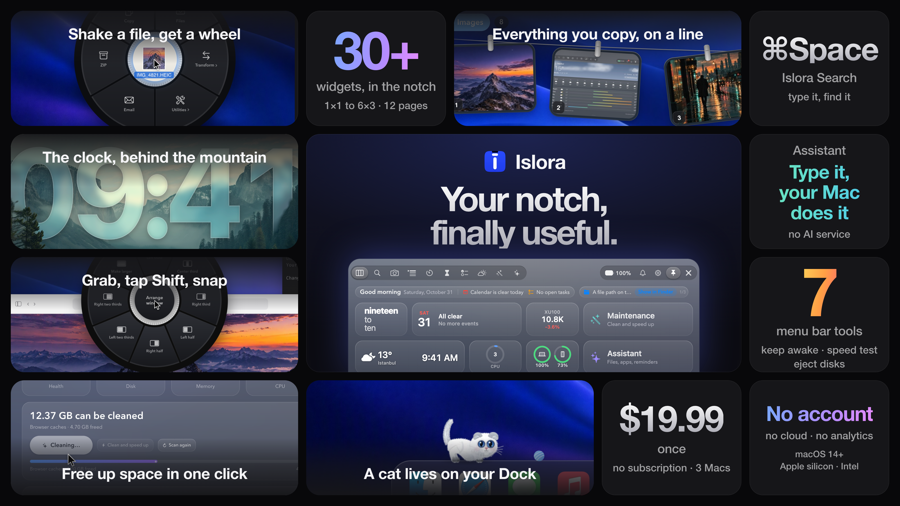

# Islora

**Your MacBook's notch has been dead space since 2021. Islora turns it into a home screen, and gives your Mac a new Dock and lock screen while it's at it.**

## What it does
- **Widgets in the notch:** calendar, weather, music, battery, notes and 30+ more, on up to 12 pages, any size from 1×1 to 6×3.
- **Clipboard line:** everything you copy hangs on a rope (images, text, links). One click pastes it back.
- **Shake a file while dragging:** a wheel opens under the pointer to convert, compress, zip, AirDrop or email it.
- **Drop a file on the notch:** AirDrop it, keep it there, or convert it.
- **Islora Search (⌘Space):** finds files as you type, newest first, with typed filters.
- **Assistant:** type what you want ("put Notes and Chrome side by side") and your Mac does it, with no AI service involved.
- **Its own Dock:** pages, widgets, live window previews, and a cat that lives on it.
- **Lock screen:** the clock slips behind the mountain.
- **More:** window snapping with a Shift wheel, cleanup, and menu-bar tools (keep awake, speed test, eject all disks).

## Get it
- **Platform:** macOS 14+, Apple silicon and Intel.
- **Trial:** the full app is free for 14 days.
- **Price:** $19.99 once, no subscription, up to 3 Macs.

**https://islora.app**

## This repository
Islora is closed source. This repository is the place for **bug reports and feature requests**: open an [issue](../../issues).
